# Руководство пользователя и администратора Logbook

| Параметр | Значение |
|---|---|
| Назначение | Работа в ЭОЖ «Logbook»: журнал, наряды, смены, заземления, визы, конфликты, ЭП и администрирование (ADM-02/ADM-08) |
| Версия документа | 1.1 |
| Дата | 27.11.2026 |
| Аудитория | Сотрудники (worker), руководители (supervisor), администраторы (admin), аудиторы (auditor) |
| Связанные документы | [35_Руководство_по_установке.md](35_Руководство_по_установке.md), [RUNBOOK.md](RUNBOOK.md), [06_Контракт_API.md](06_Контракт_API.md), [27_Отчёт_Offline_Platform.md](27_Отчёт_Offline_Platform.md), [31_Отчёт_Смена.md](31_Отчёт_Смена.md), [34_Отчёт_Admin_UI.md](34_Отчёт_Admin_UI.md) |
| Иллюстрации | Скриншоты интерфейса в каталоге `screenshots/` (1280×900, демонстрационные данные) |
| Статус | Интерфейс описан по коду и проверен на изолированном стенде (dev-вход, seed-данные); ограничения перечислены в §18 |

Обозначения: **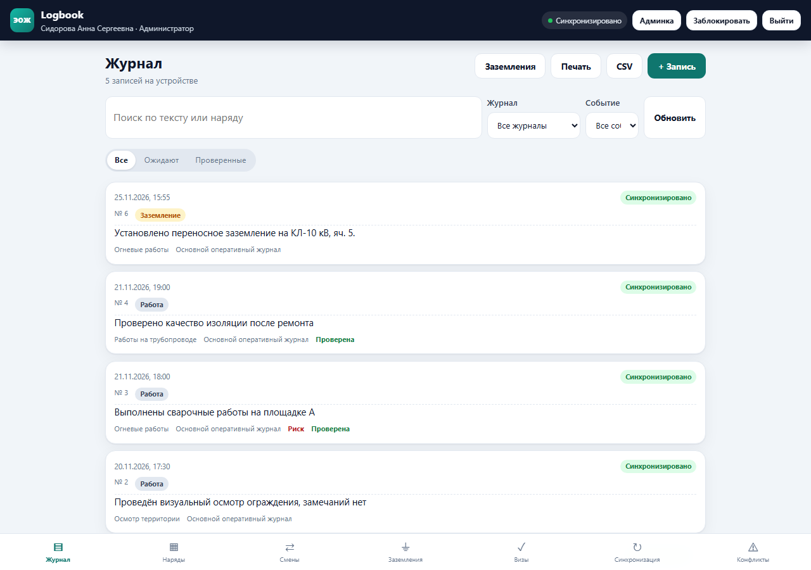** — скриншот экрана; `Моноширинный` — подпись кнопки/поля в интерфейсе; ⚠ — ограничение.

---

## 1. О системе и ролях

Logbook — электронный оперативный журнал (PWA). Работает офлайн: запись сохраняется в браузере устройства и уходит на сервер при подключении. Все действия с записями, визами и сменами попадают в неизменяемый аудит.

Роли и права (матрица из раздела «Роли» админки):

| Возможность | Сотрудник | Руководитель | Администратор | Аудитор |
|---|:--:|:--:|:--:|:--:|
| Создание и правка своих записей | ✓ | ✓ | ✓ | — |
| Просмотр журнала подразделения | — | ✓ | ✓ | — |
| Проверка/снятие проверки записи | — | ✓ | ✓ | — |
| Сдача и приёмка смены | — | ✓ | ✓ | — |
| Визы журнала | — | ✓ | ✓ | — |
| Разбор конфликтов | — | ✓ | ✓ | — |
| Все журналы и гранты | — | — | ✓ | — |
| Пользователи, устройства, импорт, хранение | — | — | ✓ | — |
| Аудит и выгрузки (только чтение) | — | — | ✓ | ✓ |

Важно:

- самостоятельной регистрации нет: учётную запись создаёт администратор (или IdP при включённом JIT-провижининге);
- роль `auditor` не создаёт и не правит записи — только читает журнал и выгрузки (ADR-15);
- администратор **не правит текст записей** за автора: он может снять/поставить проверку, восстановить удалённую запись, управлять справочниками и пользователями.

---

## 2. Вход, блокировка и выход

### 2.1. Вход через корпоративный IdP (production)

1. Откройте адрес журнала, например `https://logbook.example.com`.
2. На экране входа нажмите `Войти через IdP`.
3. Пройдите аутентификацию у IdP (пароль, MFA — по политике организации).
4. После возврата откроется журнал. При первом входе администратор должен уже создать вашу учётную запись с тем же подтверждённым email (либо на сервере включён JIT-провижининг в заданное подразделение).

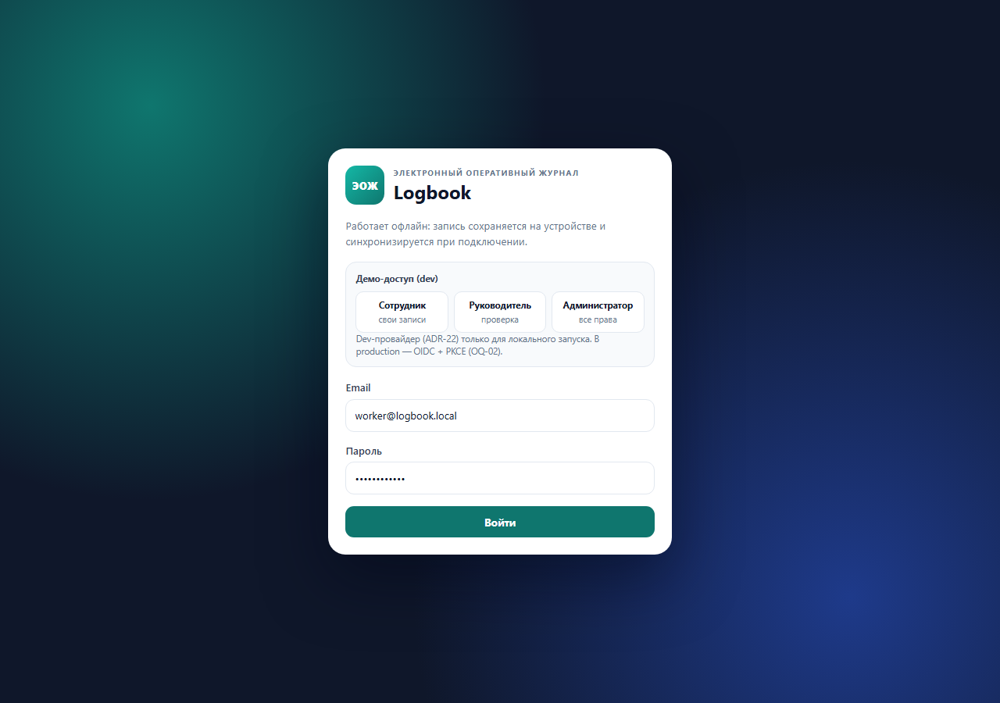

Если IdP вернул ошибку, приложение покажет её на экране входа. Типовые причины: учётная запись не создана, email не подтверждён IdP, истекла попытка входа (10 минут), не совпадает redirect URI (обратитесь к администратору).

### 2.2. Демонстрационный вход (только dev)

В демонстрационном/dev-контуре (`AUTH_PROVIDER=dev`) на экране входа доступны кнопки быстрого входа: `Сотрудник`, `Руководитель`, `Администратор`, а также форма email/пароль. Этот режим запрещён в production и не является корпоративной аутентификацией.

### 2.3. Блокировка и выход — разные действия

| Действие | Где | Что происходит |
|---|---|---|
| `Заблокировать` | шапка журнала | сессия закрывается, **локальные данные сохраняются**; разблокировка — PIN-код (если задан, работает офлайн) или повторный вход |
| `Выйти` | шапка журнала | сессия закрывается и **локальная база пользователя удаляется** вместе с неотправленной очередью, черновиками и локальным PIN |

⚠ Если в очереди есть несохранённые на сервере записи, `Выйти` удалит их безвозвратно. Перед выходом дождитесь статуса «Синхронизировано» (см. §13).

Сессия действует 30 дней (`SESSION_TTL_DAYS`). Пока вкладка открыта, приложение работает с локальным кэшем и без сети; после перезагрузки без сети сессия восстанавливается с устройства (см. §2.4), если срок не истёк.

### 2.4. PIN и офлайн-разблокировка (AUTH-03)

PIN — локальная защита на устройстве: он нужен после кнопки `Заблокировать` и после перезагрузки без сети. PIN не заменяет пароль/IdP и **не шифрует** IndexedDB (шифрование — SYN-03/OQ-09).

**Задать PIN:** `Синхронизация` → `Безопасность` → PIN из 4–8 цифр → `Задать PIN`. Там же можно `Сменить PIN` и `Удалить PIN`. Слабые PIN (`1234`, `0000` и подобные) отклоняются.

| Ситуация | Что произойдёт |
|---|---|
| Нажали `Заблокировать` (PIN задан) | Экран «Сессия заблокирована»; введите PIN — журнал откроется, данные и очередь сохранятся |
| Забыли PIN | Войдите онлайн по паролю/IdP, затем задайте новый PIN в `Безопасность`. Офлайн разблокировка при забытом PIN невозможна |
| 5 неверных PIN подряд | Разблокировка блокируется на 5 минут; счётчик сохраняется при перезагрузке |
| Перезагрузили страницу без сети (сессия не заблокирована) | Последний аккаунт восстанавливается автоматически из IndexedDB до истечения срока сессии; журнал доступен, синхронизация — при подключении |
| Перезагрузили страницу без сети (сессия была заблокирована) | Показывается PIN-экран; после PIN журнал открывается |
| Срок офлайн-сессии истёк | Восстановление не выполняется: «Офлайн-сессия не найдена или истекла» — войдите при подключении |
| `Выйти` | Локальный PIN и офлайн-сессия удаляются вместе с базой пользователя; на другом аккаунте PIN не действует |

Как хранится PIN: только PBKDF2-SHA256-verifier (случайная соль, 150 000 итераций) в `logbook:device` → `meta` → `offline_session:<user_id>`; сам PIN не сохраняется. Правила восстановления и диагностика — RUNBOOK §3.6.2.

---

## 3. Операционная оболочка

После входа доступны разделы (нижнее меню и шапка):

| Раздел | Что внутри |
|---|---|
| `Журнал` | лента записей, поиск, фильтры, создание записи, печать, CSV |
| `Наряды` | справочник нарядов, PDF и deep link источника |
| `Смены` | сдача/приёмка смены, печатный акт |
| `Заземления` | реестр переносных заземлений и ЗН |
| `Визы` | проверки ведения журнала руководителем |
| `Синхронизация` | очередь операций, ошибки, кэш руководителя |
| `Конфликты` | разбор расхождений с сервером |
| `Админка` | только для роли `admin` |

В шапке: имя и роль, индикатор синхронизации, `Админка` (для admin), `Заблокировать`, `Выйти`.

Статусы синхронизации записи:

| Бейдж | Значение |
|---|---|
| `Синхронизировано` | запись на сервере, номер присвоен |
| `Ожидает` | сохранено на устройстве, будет отправлено при подключении |
| `Конфликт` | сервер нашёл расхождение, нужен разбор (§8) |
| `Ошибка` (`dead`) | операция не отправлена после 10 попыток; требуется ручное действие в «Синхронизации» |

---

## 4. Журнал: поиск, фильтры, лента

1. `Поиск по тексту или наряду` — ищет по тексту записи и номеру наряда.
2. `Журнал` — фильтр по журналу (доступные журналы приходят с сервера; журнал `main` доступен всем, остальные — по гранту).
3. `Событие` — фильтр по типу: работа, команда, переключение, заземление, инцидент, другое.
4. Вкладки `Все` / `Ожидают` / `Проверенные` — состояние записи.
5. `Обновить` — запускает синхронизацию.
6. `+ Запись` — создать запись (в выбранном журнале).
7. `Заземления`, `Печать`, `CSV` — быстрые переходы; CSV выгружает журнал (с учётом выбранного журнала).

В карточке ленты: дата/время, номер записи (`№`), тип события, текст, тип работ, журнал, номер наряда, метки `Риск`, `Проверена`, `Пропущенная запись`.

Если открыть журнал по ссылке со сменой (`/?shift_id=...`), появится баннер «Записи смены» с периодом и статусом; список фильтруется по журналу и окну смены.

---

## 5. Создание записи

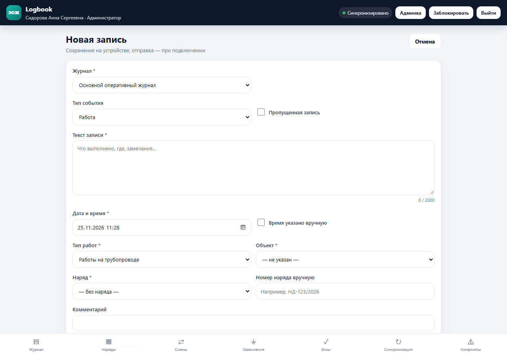

Поля и правила:

| Поле | Обязательность | Комментарий |
|---|---|---|
| `Журнал` | да | после сохранения изменить нельзя |
| `Тип события` | да | работа / команда / переключение / заземление / инцидент / другое; для каждого типа — свой блок полей |
| `Пропущенная запись` | нет | отметить, если запись вносится задним числом |
| `Текст записи` | да | до 2000 символов, счётчик под полем |
| `Дата и время` | да | по умолчанию — текущее; `Время указано вручную`, если время отличается от системного |
| `Тип работ` | да | из справочника; от типа зависит необходимость объекта и наряда |
| `Объект` | если требуется типом работ | из справочника объектов |
| `Наряд` | если требуется типом работ | выбор из импортированных нарядов; либо `Номер наряда вручную` |
| `Комментарий` | нет | до 500 символов |
| `Работы с повышенным риском` | нет | при отметке обязательна `Причина риска` |

Структурированные блоки:

- **Команда/распоряжение** — кто отдал команду, причина отказа (если был).
- **Переключение** — номер бланка/распоряжения, дата, ответственный, пункты/оборудование, последовательность операций (`Отключить`, `Включить`, `Проверить`, `Измерить`, `Другое`) с аппаратом и состояниями «из/в», а также проверки с отметкой «пройдена».
- **Заземление (З/З, ЗН)** — действие (`Установлено`/`Снято`), тип (`Переносное З/З`/`Заземляющие ножи`), точка установки (обязательно), номер средства защиты, количество.
- **Инцидент/авария** — тяжесть (`Незначительная`/`Серьёзная`/`Критическая`), причина, действия.
- **Другое** — описание события.

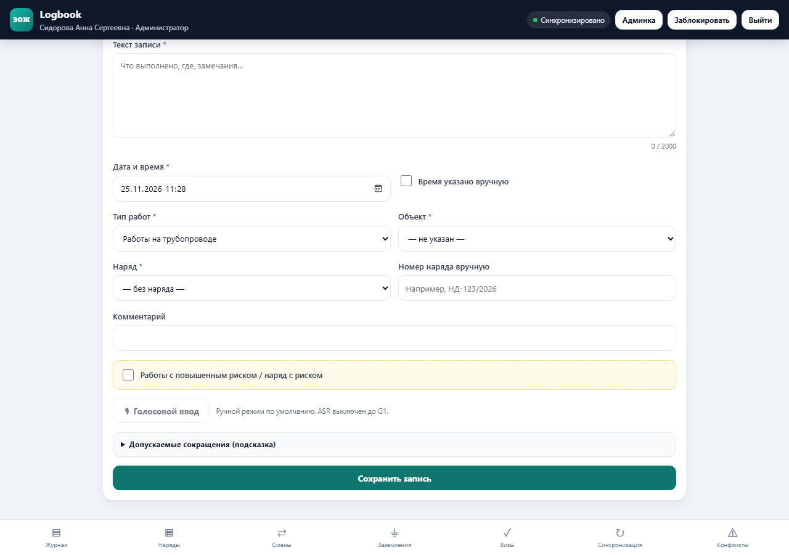

Поведение:

- запись сохраняется **на устройстве** сразу; отправка на сервер — при подключении (кнопка `Сохранить запись`);
- черновик автоматически сохраняется через 1,5 с после последнего изменения (подпись «Черновик сохранён»); при повторном открытии формы черновик подставляется;
- `🎙 Голосовой ввод` отключён до решения G1 — ручной режим по умолчанию;
- если сервер скорректировал время, при редактировании появится предупреждение и флажок `Согласен заменить серверное время`;
- под формой — подсказка допускаемых сокращений (приложение 2 к письму 42-6/35-ЭТ).

Ошибки валидации показываются под полями: «Для этого типа работ нужен наряд», «Укажите объект», превышение длины текста и т. п. Данные не теряются — можно исправить и сохранить снова.

---

## 6. Карточка записи

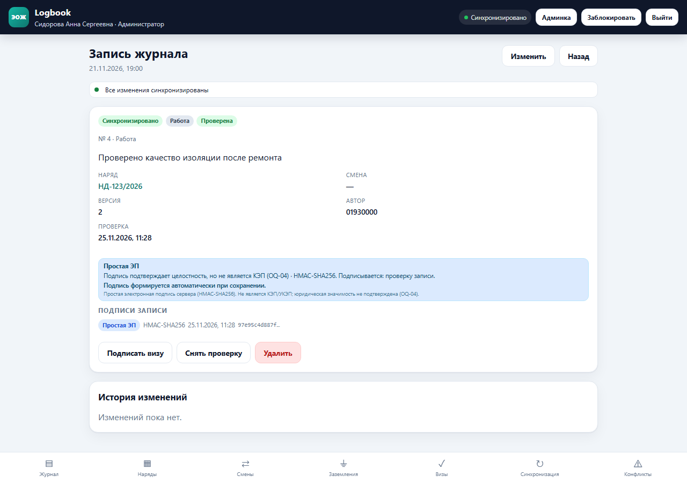

В карточке: статус синхронизации, тип события, метки `Проверена`/`Риск`/`Удалена`/`Пропущенная запись`, номер и текст, комментарий, структурированные данные события (для переключений и заземлений — таблицей, плюс раскрываемый JSON), ссылки на наряд и смену, версия, автор, дата проверки, подписи.

Действия:

| Кнопка | Кто видит | Когда доступна |
|---|---|---|
| `Проверить` | руководитель, администратор | запись активна, ещё не проверена, синхронизирована |
| `Подписать визу` | руководитель, администратор | запись проверена, ЭП настроена (`simple`/`qualified`), синхронизирована |
| `Снять проверку` | руководитель, администратор | запись проверена |
| `Восстановить` | администратор | запись удалена |
| `Удалить` | автор, руководитель подразделения, администратор | запись активна; удаление уйдёт на сервер при синхронизации |
| `Изменить` | автор / руководитель подразделения / администратор | запись не в состоянии конфликта |

Ниже — «История изменений»: ревизии с различиями полей (`было → стало`).

⚠ Пока запись не синхронизирована, проверка и подпись недоступны — приложение честно показывает предупреждение.

---

## 7. Проверка записей, визы и ЭП

### 7.1. Проверка записи

Руководитель открывает запись, проверяет текст и нажимает `Проверить`. Запись получает отметку «Проверена», в аудит пишется `entry.verify`, при настроенной ЭП автоматически формируется подпись визы (`SIGNATURE_AUTO_SIGN=true` для `simple`). Снять проверку можно кнопкой `Снять проверку` — подпись переходит в статус `revoked`.

### 7.2. Визы журнала

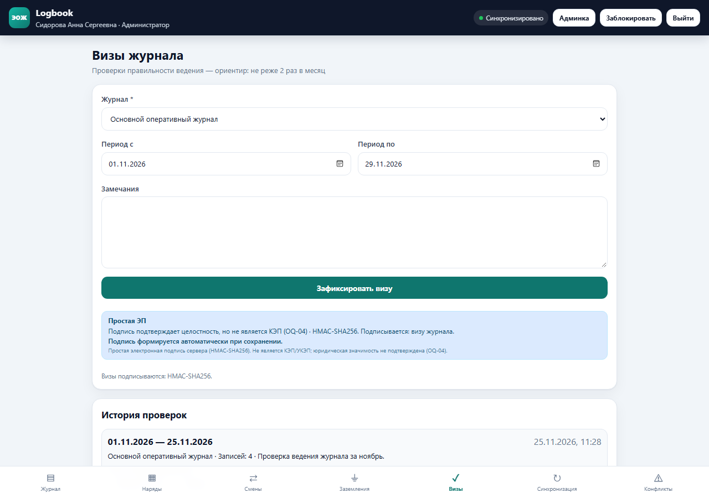

Раздел `Визы` доступен руководителю и администратору. Ориентир — не реже 2 раз в месяц.

1. Выберите журнал.
2. Укажите период (`Период с` / `Период по`) и замечания.
3. Нажмите `Зафиксировать визу`.
4. Сервер считает количество записей и hash содержимого за период; виза появляется в «Истории проверок».
5. При настроенной ЭП виза подписывается автоматически; вручную — кнопкой `Подписать визу`. Кнопка `Подписи` загружает подписи визы.

⚠ Визу можно зафиксировать только онлайн: офлайн-очередь виз не реализована (JRN-08), экран об этом предупреждает.

### 7.3. Электронная подпись (OQ-04)

| Режим | Что видит пользователь |
|---|---|
| `none` | «ЭП не настроена: визы фиксируются в аудите без подписи» |
| `simple` | «Простая ЭП: подтверждает целостность, но не является КЭП/УКЭП» + алгоритм и подсказка об автоподписи |
| `qualified` | «Подписывается сервисом КЭП»; подпись запрашивается вручную |

В карточке подписи показываются вид, алгоритм, время, сертификат (для КЭП), hash и статус (`valid` / `invalid` / `revoked`). Подпись проверяется по актуальному содержимому: изменение записи после подписания делает её недействительной при проверке.

⚠ Юридическая значимость ЭП не подтверждена (OQ-04). `simple` — только целостность; для КЭП требуется интеграция с УЦ. В печатных формах выводится оговорка.

---

## 8. Конфликты

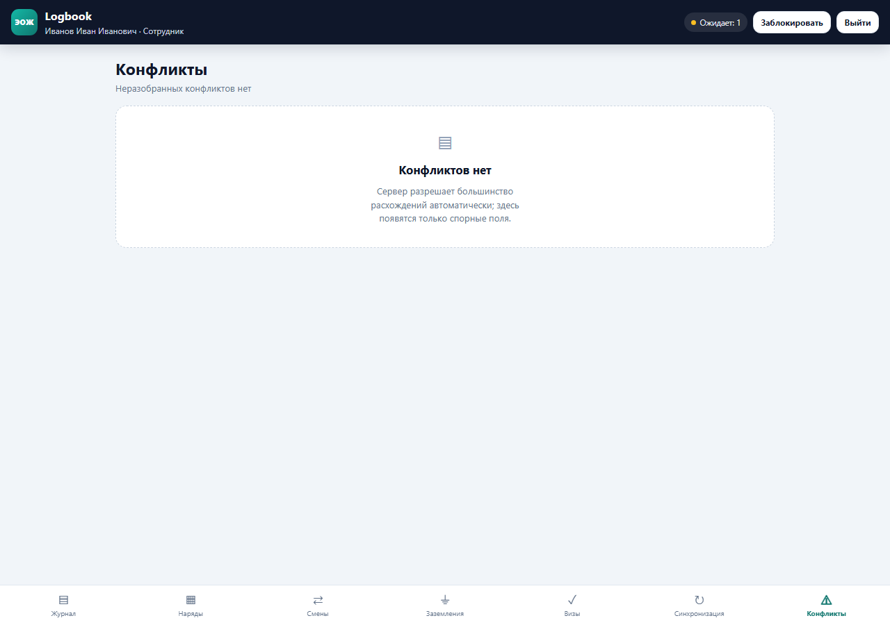

Конфликт возникает, когда локальная правка расходится с серверной (например, запись проверили, а затем изменили на устройстве). Большинство расхождений сервер разрешает автоматически (C-01…C-12); в разделе показываются только спорные поля.

Для каждого конфликта видно: поле, локальное и серверное значения с HLC-метками, автора/время.

Действия руководителя/администратора:

| Кнопка | Результат |
|---|---|
| `Оставить локальное` | на сервер отправляется локальное значение |
| `Принять серверное` | локальная правка отбрасывается |
| `Разобрать вручную` | конфликт помечается разобранным вручную (без автоматической замены) |

Количество неразобранных конфликтов отображается бейджем у пункта `Конфликты`.

⚠ Раздел показывает конфликты, зафиксированные на **этом** устройстве. Конфликт, возникший на другом устройстве, может не появиться здесь до локальной отправки: отдельная загрузка серверных конфликтов в интерфейс пока не подключена (`pullServerConflicts` реализован в sync-слое, но не вызывается экраном). Серверный список доступен администратору через `GET /v1/conflicts`.

---

## 9. Наряды

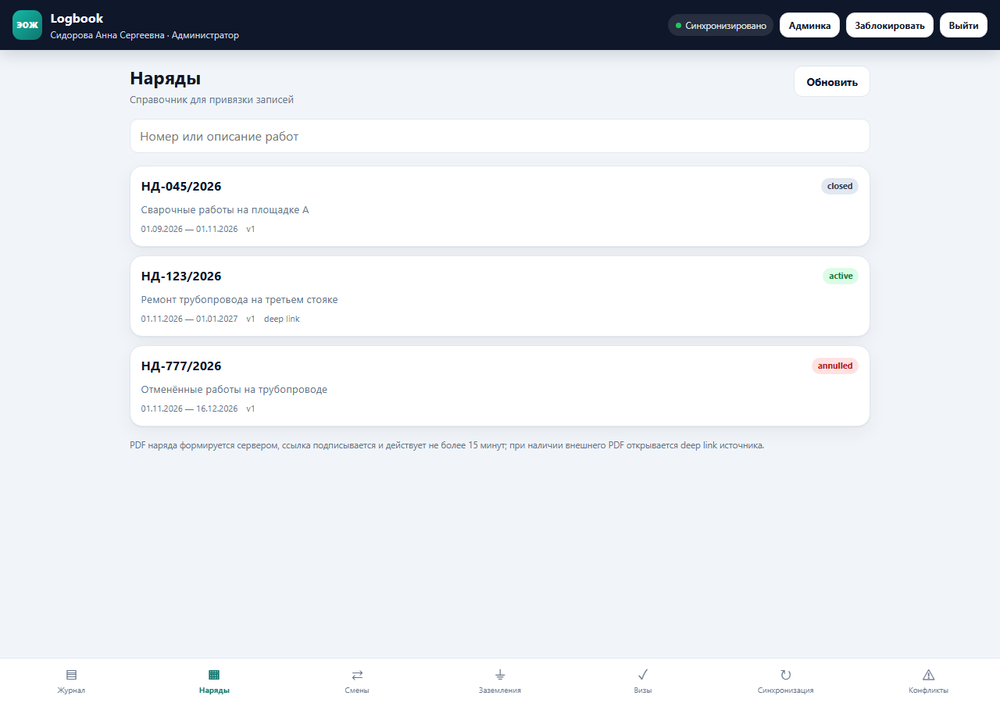

Раздел `Наряды` — справочник для привязки записей. Наряды импортирует администратор (§15.6); после синхронизации они доступны офлайн.

1. Найдите наряд по номеру или описанию работ.
2. Откройте карточку: статус, год, срок действия, версия, источник, deep link.
3. `PDF наряда` — сервер формирует PDF и выдаёт подписанную ссылку; ссылка действует до 15 минут. Если у наряда есть внешний PDF, откроется он (302 на источник).
4. `PDF источника` — прямая ссылка на файл внешней системы.

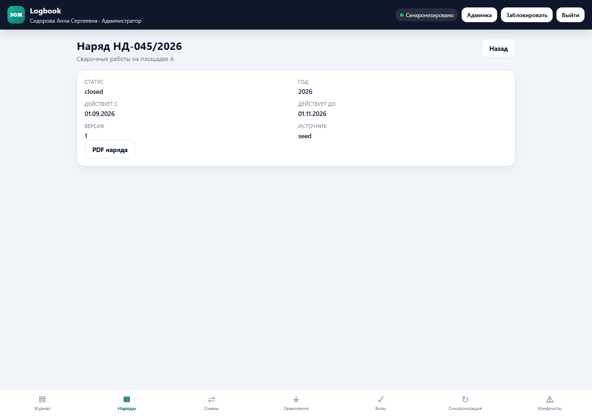

В списке метки `PDF` и `deep link` показывают наличие документов. Ошибка «PDF недоступен» означает, что сервер не смог сформировать файл или истекла ссылка — повторите нажатие.

---

## 10. Смены

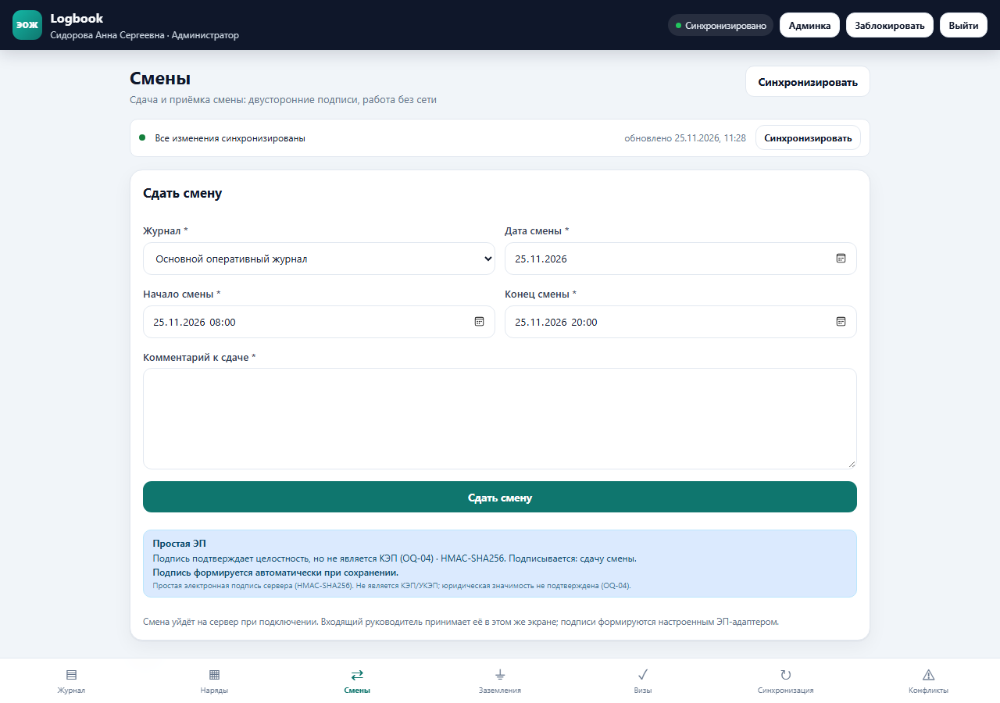

Раздел доступен всем для просмотра, сдавать и принимать смену может руководитель или администратор.

### 10.1. Сдать смену

1. Выберите журнал и дату смены (окно по умолчанию 08:00–20:00, можно изменить).
2. Заполните `Комментарий к сдаче` (обязательно).
3. Нажмите `Сдать смену`. Смена сохраняется локально и уходит на сервер при подключении; подписи появятся после синхронизации.
4. В списке отображаются статус, число записей смены, кто сдал/принял, hash и подписи.

### 10.2. Принять или отклонить

Входящий руководитель (не автор сдачи) видит кнопки `Принять смену` и `Отклонить`:

- `Принять смену` — фиксирует приёмку и подпись принимающего;
- `Отклонить` — требует `Причину отклонения`; после отклонения смену можно сдать заново.

Ограничения: нельзя принять собственную смену; активная смена одна на окно журнала; при расхождении с сервером появляется кнопка `Сверить с сервером`.

`Печать` формирует акт сдачи-приёмки с подписями сторон и оговоркой об ЭП; `Записи смены` открывает журнал, отфильтрованный по окну смены.

---

## 11. Заземления

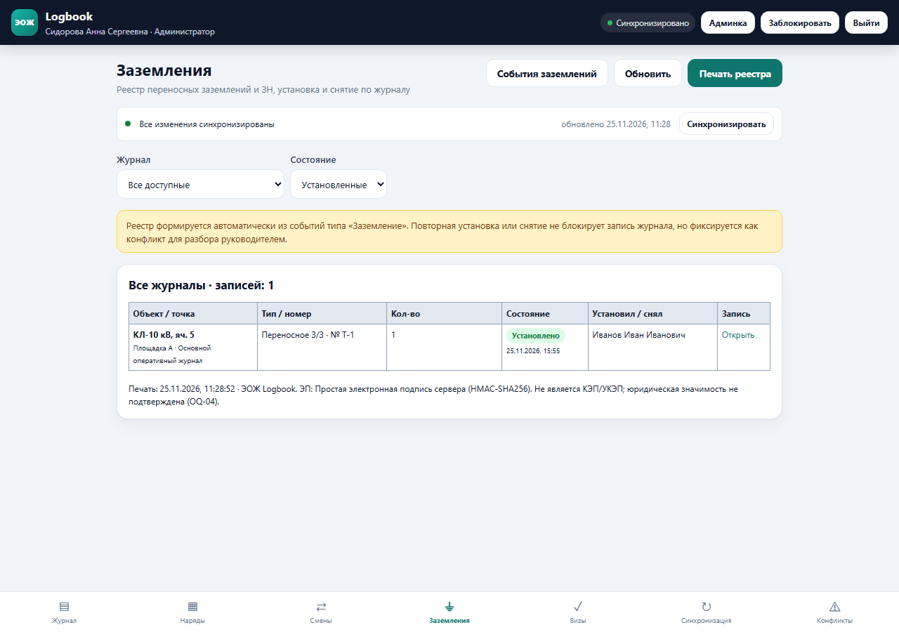

Реестр формируется автоматически из записей с типом события «Заземление»:

- `applied` открывает строку реестра, `removed` закрывает её;
- фильтры: журнал и состояние (`Установленные` / `Снятые`);
- столбцы: объект/точка, тип/номер, количество, состояние и время, кто установил/снял, ссылка на исходную запись;
- `Печать реестра` выводит таблицу с оговоркой об ЭП.

⚠ Повторная установка или снятие не блокирует запись, но фиксируется как конфликт для разбора руководителем. Событие заземления неизменяемо: для нового состояния создайте новую запись.

---

## 12. Печать журнала и CSV

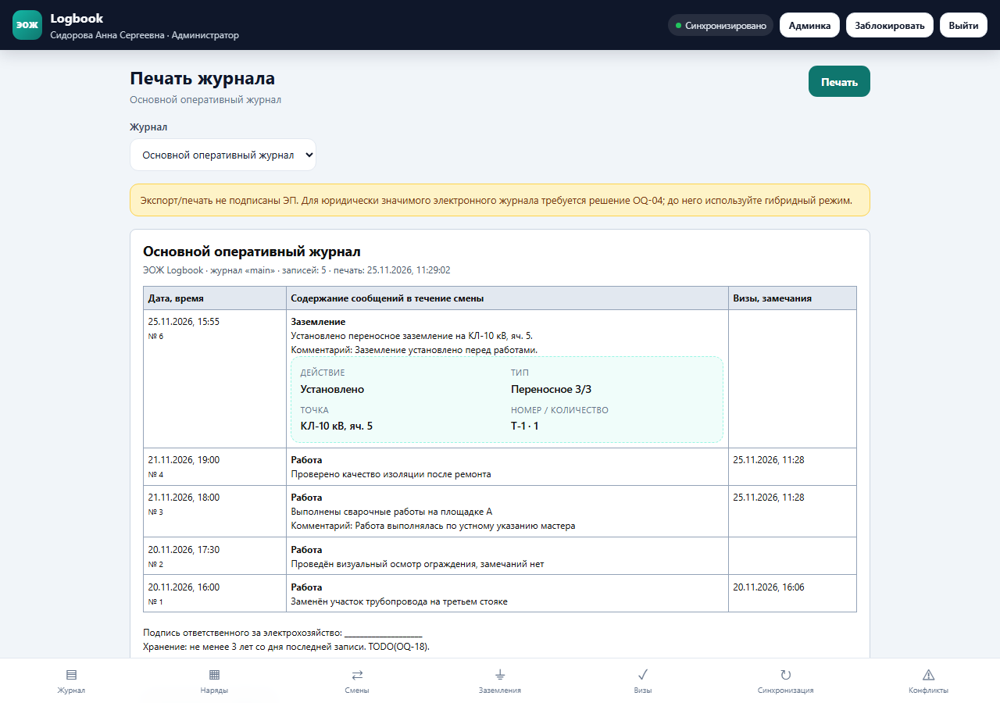

1. В журнале нажмите `Печать` (или `Печать` в разделе «Журнал»).
2. Выберите журнал; форма строится по трём графам: дата/№, содержание, визы/замечания.
3. Нажмите `Печать` — браузер откроет системный диалог.

Экран предупреждает, что печать/экспорт не подписаны ЭП; для юридически значимого журнала требуется решение OQ-04 (гибридный режим). Ниже формы — список допускаемых сокращений.

CSV выгружается кнопкой `CSV` в журнале; колонки: `journal_seq`, дата/время, содержание, визы/замечания, тип события, автор, наряд, признак пропущенной записи, ключ журнала.

---

## 13. Синхронизация и офлайн-работа

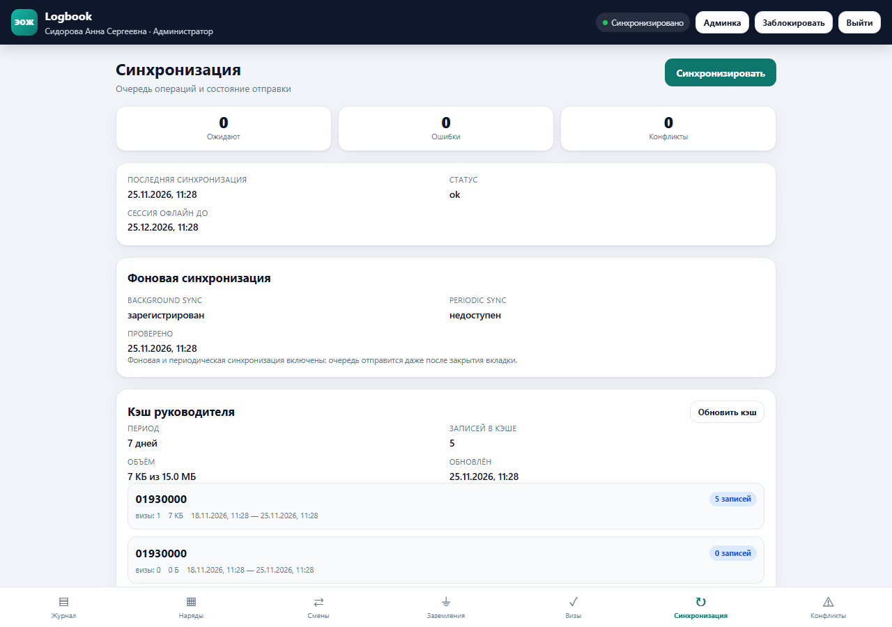

Раздел `Синхронизация` показывает:

- счётчики `Ожидают`, `Ошибки`, `Конфликты`;
- время последней синхронизации и статус;
- срок офлайн-сессии;
- `Безопасность`: статус PIN, `Задать PIN`/`Сменить PIN`/`Удалить PIN` (4–8 цифр; хранится только PBKDF2-хэш) — см. §2.4;
- возможности браузера: `Background Sync`, `Periodic Sync` и подсказку;
- `Кэш руководителя` (для supervisor/admin): период 7 дней, число записей, объём из 15 МиБ, разбивка по журналам, кнопка `Обновить кэш`;
- очередь операций: тип, запись, попытки, следующая попытка, текст ошибки; для `dead` — кнопка `Повторить`.

Кнопка `Синхронизировать` запускает отправку и получение изменений. Отправка идёт пакетами до 50 операций с повторами (backoff 2–15 минут); после 10 неудач операция помечается `dead` и требует ручного повтора.

> ✅ Проверено 25.11.2026: экран `/sync` открывается, показывает счётчики, фоновую синхронизацию, кэш руководителя и очередь. Ранее найденный белый экран (ошибка схемы `outbox.created_at`) исправлен в t19 — обновите PWA после выпуска.

### Офлайн-правила

| Правило | Последствие |
|---|---|
| Запись создаётся офлайн | сохраняется в IndexedDB устройства, номер присваивается после синхронизации |
| `Заблокировать` | данные остаются на устройстве; разблокировка — PIN (офлайн) или повторный вход |
| Перезагрузка без сети | последний аккаунт восстанавливается автоматически (если сессия не заблокирована и срок не истёк); при блокировке — PIN-экран |
| Истёк срок офлайн-сессии | восстановление невозможно, нужен вход при подключении (срок по OQ-27) |
| `Выйти` | база пользователя и локальный PIN удаляются, очередь пропадает |
| Фоновая отправка | Chrome/Edge — после закрытия вкладки; Safari/iOS — только при следующем открытии |
| Кэш руководителя | последние 7 дней каждого журнала и визы, не чаще раза в 6 часов (кнопка — принудительно) |

Диагностика в браузере (DevTools → Application → IndexedDB): `logbook:device` (идентичность устройства, ключ, статус фоновой синхронизации, `offline_session:<id>` с PBKDF2-verifier — без открытого PIN) и `logbook:user:<id>` (записи, черновики, очередь, кэш). При сбое миграции локальной базы приложение покажет ошибку и не откроет повреждённый кэш; снимок остаётся в `logbook:...#snapshot:<ts>`.

---

## 14. Административный контур

Админка доступна только роли `admin` — по адресу `/admin` на основном домене или на отдельном origin `https://admin.logbook.example.com` (ADR-14). В операционной оболочке — кнопка `Админка`; не-администратор увидит предупреждение «Администрирование доступно только администратору».

Разделы: `Обзор`, `Пользователи`, `Роли`, `Журналы`, `Устройства`, `Импорт нарядов`, `Хранение`, `Экспорт`, `Аудит`. Все действия администратора аудируются (`user.create`, `user.update`, `device.revoke`, `journal.*`, `permit.import`, `retention.*`, `backup.checkpoint` и др.).

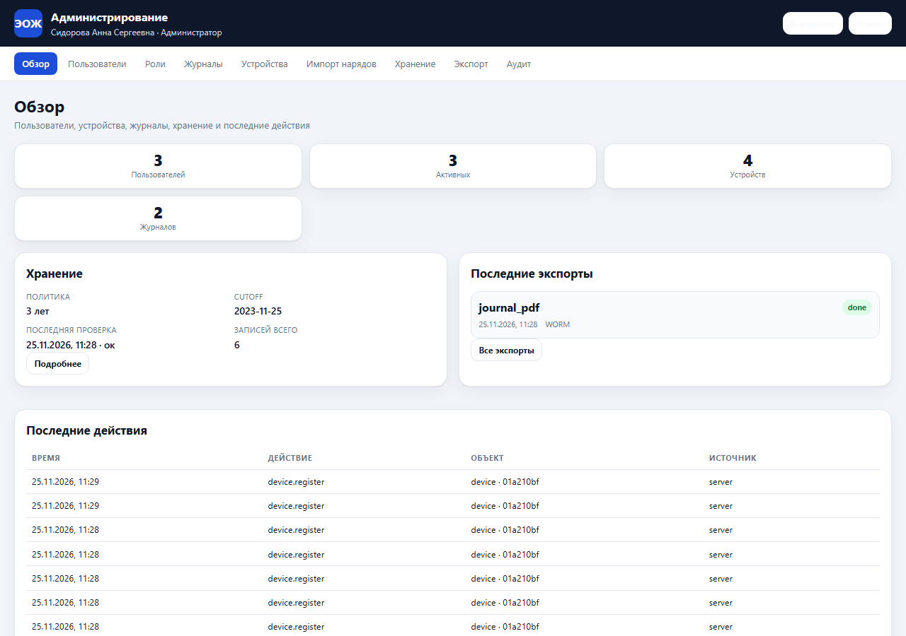

`Обзор` — счётчики пользователей/активных/устройств/журналов, политика хранения и cutoff, последние экспорты и последние действия.

### 14.1. Пользователи

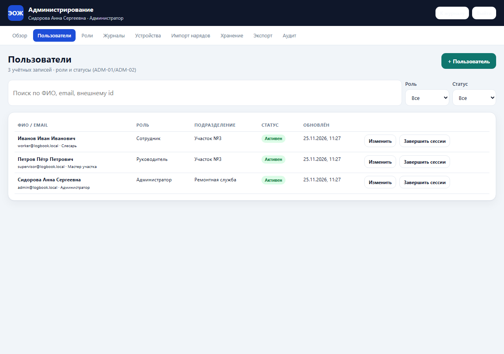

1. `+ Пользователь` открывает форму: `Email`, `ФИО`, `Роль`, `Подразделение`, `Должность` (необязательно), внешний ID (необязательно).
2. Поиск — по ФИО, email, внешнему ID; фильтры — роль и статус.
3. `Изменить` в строке включает выбор роли и статуса; `Готово` закрывает редактирование. Изменения сохраняются сразу.
4. `Завершить сессии` принудительно завершает все сессии пользователя (например, при утере устройства).

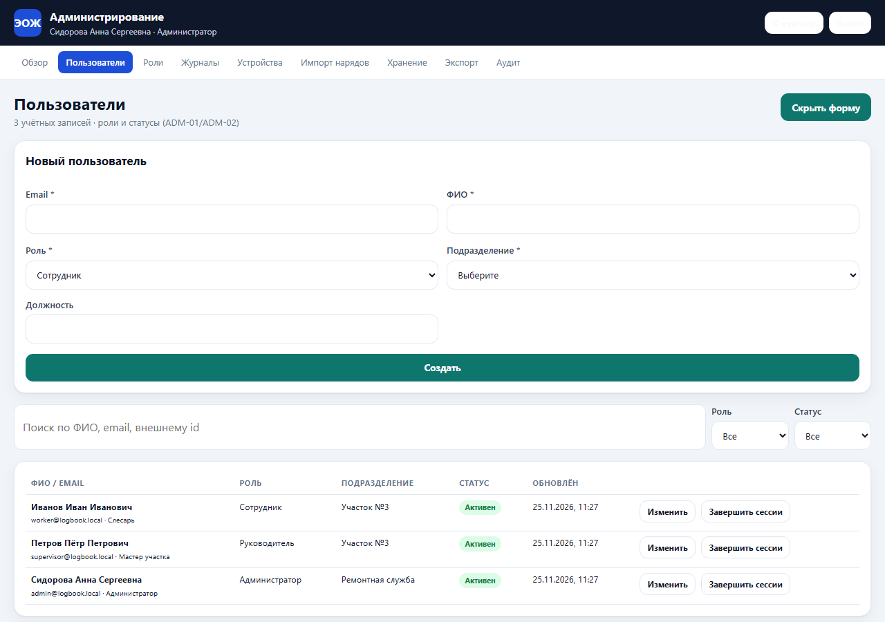

Правила:

- удаления пользователей нет — только статусы `Активен`, `Заблокирован`, `Деактивирован`; заблокированный не может войти, его данные остаются;
- email должен совпадать с подтверждённым email в IdP, иначе первый вход не привяжется;
- роли назначаются здесь же (раздел «Роли» — справочник матрицы прав).

### 14.2. Роли

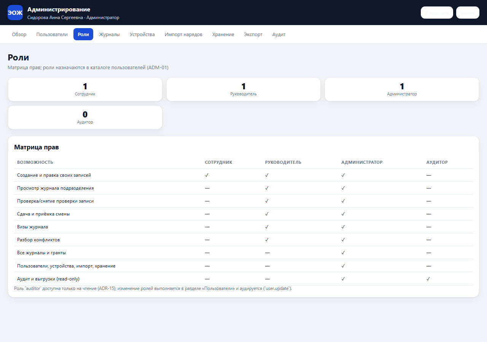

Счётчики по ролям и матрица прав (см. §1). Роли назначаются в «Пользователях»; изменение роли аудируется. `auditor` — только чтение.

### 14.3. Журналы и гранты

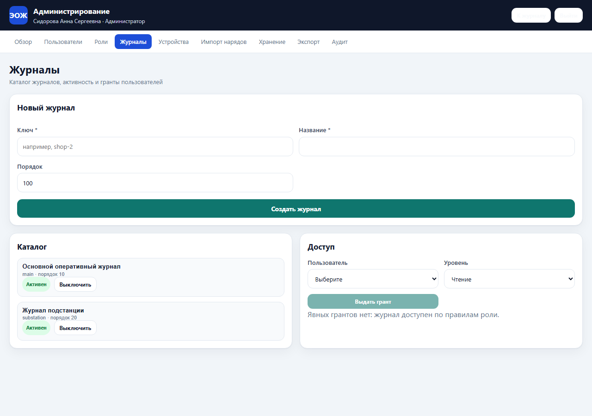

1. `Новый журнал`: `Ключ` (латиница, цифры, `-`/`_`), `Название`, `Порядок`.
2. В каталоге выберите журнал; кнопка `Выключить`/`Включить` меняет его активность.
3. `Доступ`: выберите пользователя, уровень (`Чтение` / `Запись` / `Управление`) и нажмите `Выдать грант`.
4. Выданные гранты видны в таблице; `Отозвать` удаляет доступ.

Правила: журнал `main` доступен всем; остальные — только по гранту; `admin` управляет всеми, `auditor` читает активные. Если явных грантов нет, действуют правила роли.

### 14.4. Устройства

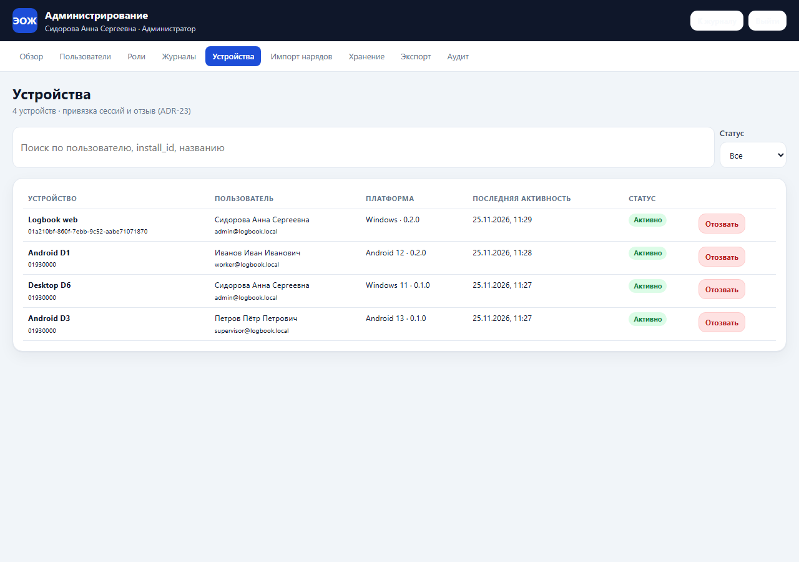

Список всех устройств с поиском (пользователь, `install_id`, название) и фильтром статуса. `Отозвать` завершает сессии устройства и запрещает синхронизацию с него; вернуть устройство можно только повторной регистрацией/новым устройством по решению администратора. Действие необратимо — убедитесь, что это устройство пользователя, а не его единственный рабочий телефон.

### 14.5. Импорт нарядов

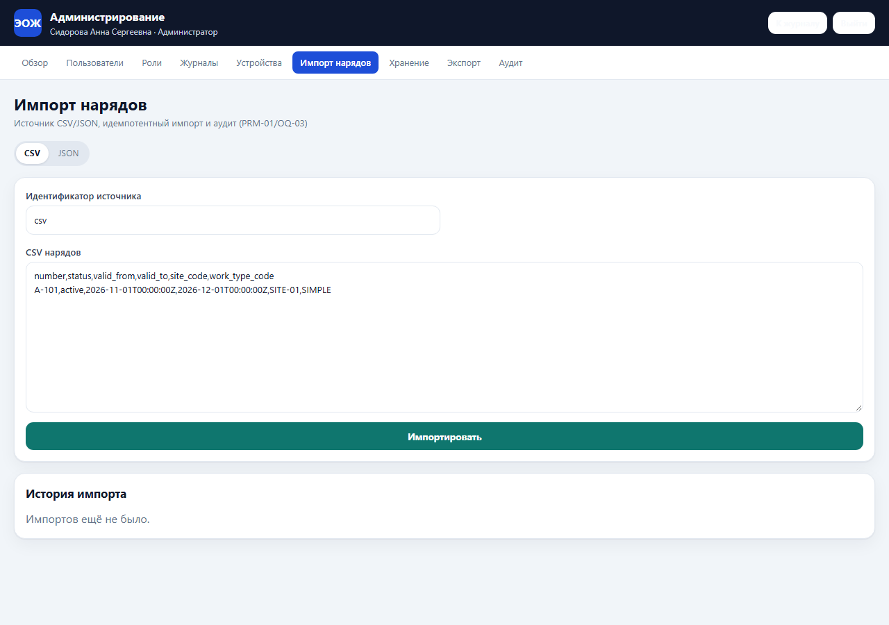

1. Выберите формат: `CSV` или `JSON`.
2. Укажите `Идентификатор источника` (например, `csv` или `external-json`).
3. Вставьте данные в поле (для CSV — заголовок и строки; пример показан в форме).
4. Нажмите `Импортировать`.

Результат: `Создано`, `Обновлено`, `Ошибок`; ошибки перечислены по номерам строк. История импорта хранится внизу и в аудите. Повторный импорт идемпотентен по `(source_id, external_id)` — дубли не создаются. Ошибки строк не прерывают импорт остальных записей.

Минимальные поля CSV: `number`, `status`, `valid_from`, `valid_to`, `site_code` (остальные — по контракту API, `06_Контракт_API.md`).

### 14.6. Хранение и архив

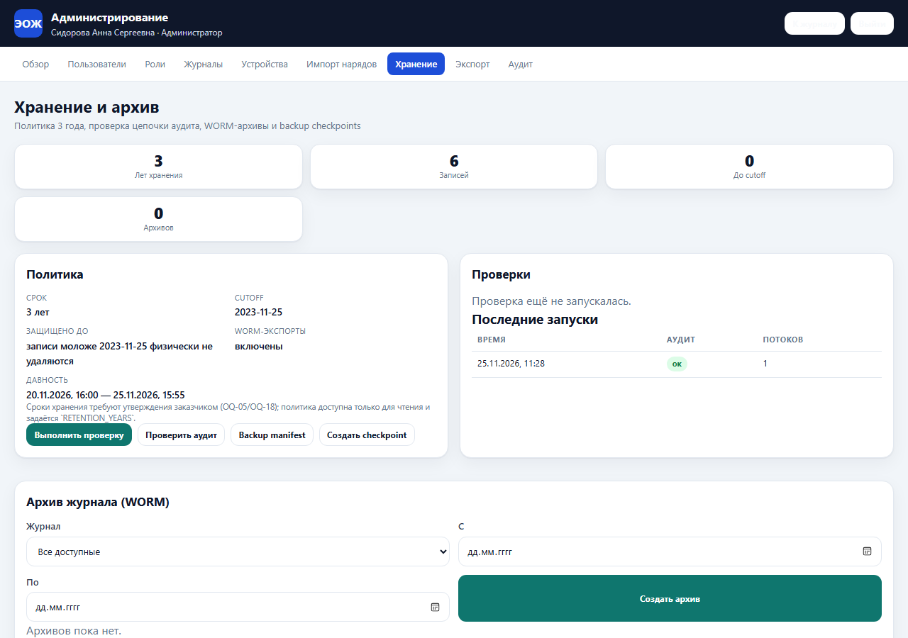

- `Политика` — срок хранения (`RETENTION_YEARS`, по умолчанию 3 года), cutoff, число записей, oldest/newest; только чтение.
- `Выполнить проверку` — отчёт о хранении + проверка hash-цепочки аудита.
- `Проверить аудит` — отдельная проверка целостности (`ок` / `нарушен`, потоки, события, разрывы).
- `Backup manifest` — снимок счётчиков таблиц и голов аудита для сверки после восстановления.
- `Создать checkpoint` — фиксирует manifest в аудите (делайте перед backup/обновлением).
- `Архив журнала (WORM)`: журнал, период `С`/`По` → `Создать архив`; архивные PDF неизменяемы, их hash виден в таблице.

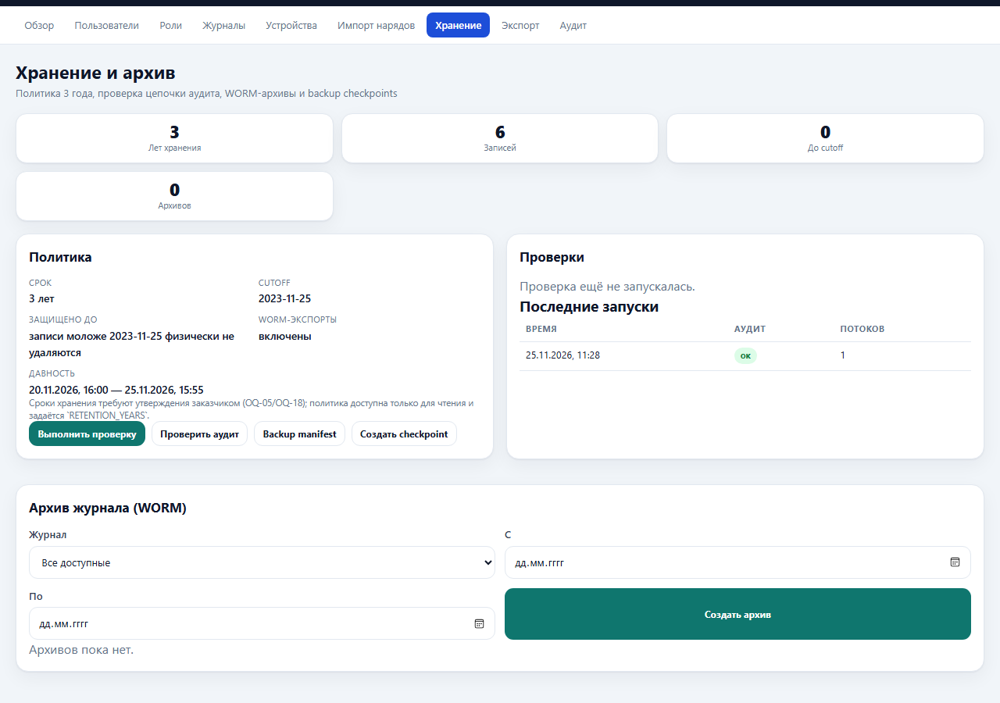

⚠ Сроки хранения и юридическая значимость архива требуют утверждения (OQ-05/OQ-18). Удаление записей моложе срока блокируется на уровне БД.

### 14.7. Экспорт журнала

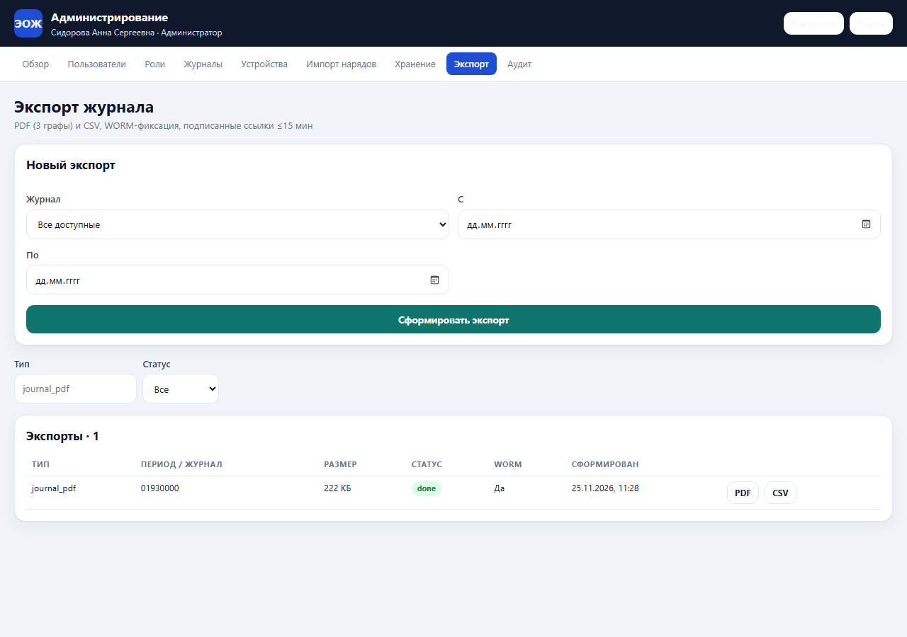

1. В форме `Новый экспорт` выберите журнал и период (пустые даты — без ограничения).
2. `Сформировать экспорт` — создаётся WORM-задача: PDF 3-графной формы и CSV.
3. В таблице экспортов: тип, период/журнал, размер, статус, признак WORM, дата.
4. Кнопки `PDF` и `CSV` получают подписанную ссылку (≤ 15 минут) и скачивают файл; завершённый экспорт не изменяется и не удаляется.

Фильтры по типу (`journal_pdf`) и статусу (`Готовые`/`В очереди`/`Ошибки`) помогают найти нужный экспорт.

### 14.8. Аудит

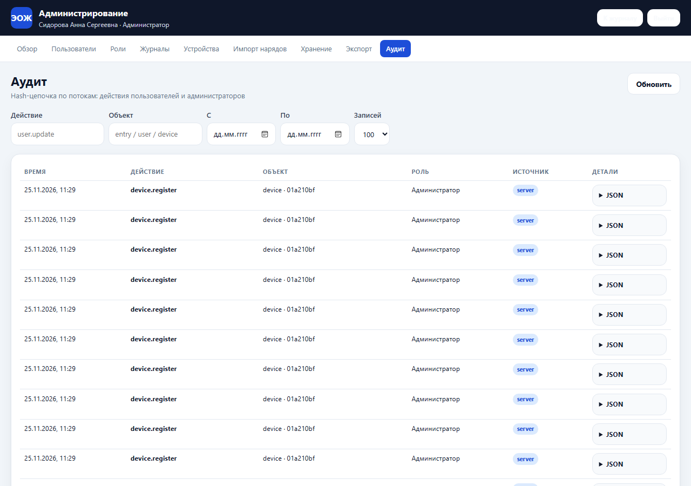

Фильтры: `Действие` (например, `user.update`), `Объект` (`entry`/`user`/`device`/`journal`/`permit`/`export`), период `С`/`По`, число записей (50/100/200). Таблица: время, действие, объект, роль, источник, детали (before/after и hash-цепочка). Аудит доступен администратору и аудитору; в операционном контуре — `GET /v1/audit`.

---

## 15. Типовые сценарии

### 15.1. Сотрудник: запись без сети

1. Включите авиарежим (или DevTools → Network → Offline).
2. `+ Запись` → заполните текст, тип работ, объект, при необходимости наряд.
3. `Сохранить запись` → карточка показывает «Ожидает».
4. Верните сеть → `Синхронизировать` (или дождитесь фоновой отправки) → статус «Синхронизировано», появился номер.

### 15.2. Руководитель: проверка и виза

1. Откройте запись сотрудника → `Проверить` (подпись визы создаётся автоматически при `simple`).
2. Раздел `Визы` → выберите журнал и период → `Зафиксировать визу`.
3. При необходимости `Подписать визу` и `Подписи` для просмотра.

### 15.3. Смена: сдать и принять

1. Руководитель: `Смены` → журнал, дата, окно, комментарий → `Сдать смену`.
2. Другой руководитель/администратор: `Принять смену` (или `Отклонить` с причиной).
3. `Печать` — акт сдачи-приёмки; `Записи смены` — журнал за окно.

### 15.4. Администратор: новый сотрудник и доступ к журналу

1. `Пользователи` → `+ Пользователь` → email, ФИО, роль `Сотрудник`, подразделение → создать.
2. Сотрудник входит через IdP — учётная запись привязывается по подтверждённому email.
3. При необходимости: `Журналы` → выбрать журнал → `Доступ` → пользователь, уровень `Запись` → `Выдать грант`.

### 15.5. Администратор: месячный экспорт и проверка

1. `Хранение` → `Создать checkpoint`.
2. `Экспорт` → журнал, период → `Сформировать экспорт`.
3. `PDF` → сохранить файл; `CSV` — для обработки.
4. `Хранение` → `Проверить аудит` → убедиться, что «ок».

---

## 16. Ошибки и что делать

| Сообщение/симптом | Причина | Действие |
|---|---|---|
| «Учётная запись не найдена. Обратитесь к администратору» | email не заведён или не совпадает с IdP | администратор создаёт пользователя с тем же email |
| «IdP не подтвердил email» | `email_verified=false` | обратиться к администратору/ИБ |
| «Администрирование доступно только администратору» | роль не admin | войти под администратором |
| «Запись ещё не синхронизирована: проверка и подпись станут доступны…» | есть очередь | синхронизировать и повторить |
| «Запись не найдена» | нет доступа или запись удалена | проверить журнал/доступ; администратор проверит restore |
| «Недостаточно прав на изменение записи» | чужая запись/подразделение | правит автор или руководитель подразделения |
| Конфликт в карточке | расхождение с сервером | раздел `Конфликты` → выбрать решение |
| `Ошибка` в очереди | 10 неудачных попыток | `Синхронизация` → `Повторить`; если повтор не помогает — администратору |
| «Нет сети: визу можно зафиксировать только на сервере» | офлайн | создать визу после подключения |
| «PDF недоступен» / ссылка не открывается | истекла подписанная ссылка (15 минут) | нажать `PDF наряда` повторно |
| «Импорт не выполнен» / ошибки строк | неверный CSV/JSON | исправить строки по сообщениям, импортировать снова |
| После `Выйти` пропали неотправленные записи | локальная база удалена | восстановить нельзя; впредь синхронизировать до выхода |
| Заблокировано → не пускает | сессия заблокирована | ввести PIN; если PIN забыт или не задан — войти по паролю/IdP (данные сохранены) |
| «Неверный PIN. Осталось попыток: N» | неверный PIN | проверить раскладку/цифры; после 5 попыток — подождать 5 минут или войти по паролю |
| «Слишком много попыток. Блокировка на 5 минут» | сработала защита PIN | подождать 5 минут/войти по паролю, затем при необходимости сменить PIN |
| «PIN не задан» на экране блокировки | PIN не был настроен до блокировки | войти по паролю/IdP; задать PIN в `Синхронизация` → `Безопасность` |
| «Офлайн-сессия не найдена или истекла» | нет сети, срок 30 дней истёк или данные устройства очищены | войти при подключении; проверить, что не выполнен `Выйти`/очистка браузера |
| PIN забыт, сети нет | офлайн-разблокировка невозможна | дождаться сети и войти по паролю/IdP; PIN хранится только как хэш, восстановить его нельзя |

---

## 17. Подсказки по работе

- Печатные формы и реестры открываются в отдельном представлении; для PDF используйте системный диалог печати («Сохранить как PDF»).
- Поиск в журнале сбрасывается кнопкой `Сбросить`.
- Ссылки с параметрами (`?journal_id=`, `?event_type=grounding`, `?shift_id=`) можно сохранять в закладки — фильтр применится при открытии.
- В админке фильтры применяются автоматически (без кнопки «Найти»).

---

## 18. Ограничения и открытые вопросы

| Ограничение | Что это значит для пользователя |
|---|---|
| OQ-02: реальный IdP не подключён в демо | в демо используется dev-вход; в production вход только через IdP |
| OQ-04: ЭП не является КЭП | подписи `simple` подтверждают целостность, но не юридическую значимость; печать — с оговоркой |
| OQ-05/OQ-18: сроки хранения не утверждены | политика 3 года — настройка, а не утверждённый регламент |
| OQ-21: per-user IndexedDB требует подтверждения ИБ | локальные данные не шифруются; PIN защищает интерфейс, но не диск (SYN-03/OQ-09) |
| Нет офлайн-очереди виз (JRN-08) | визы создаются только онлайн |
| Конфликты с других устройств | подтягиваются при синхронизации (t20); если не появились — `Синхронизация` → `Синхронизировать` |
| Нет вложений и голосового ввода | ASR выключен до G1; вложения не поддерживаются |
| Нет удаления пользователей | только блокировка/деактивация |
| Администратор не правит текст записи | исправления — автором или через конфликт/восстановление |
| Ограничения PIN | 4–8 цифр, 5 попыток/5 минут; офлайн-сессия 30 дней (OQ-27); забытый PIN восстанавливается только входом по паролю/IdP |
| Аудит и выгрузки | только чтение; редактирование событий аудита невозможно |

Открытые вопросы перечислены в [03_Реестр_вопросов_заказчику.md](03_Реестр_вопросов_заказчику.md); статус — в [24_Остаток_разработки.md](24_Остаток_разработки.md).

---

## Приложение A. Карта экранов

| Маршрут | Экран | Роли |
|---|---|---|
| `/login` | вход (OIDC или dev) | все |
| `/` | журнал (S-02) | все авторизованные |
| `/entries/new` | новая запись (S-03) | worker, supervisor, admin |
| `/entries/:id` | карточка записи (S-05) | по доступу к журналу |
| `/entries/:id/edit` | редактирование (S-03) | автор/руководитель подразделения/admin |
| `/permits` | наряды (S-07) | все |
| `/shifts` | смены (S-15) | все; сдача/приёмка — supervisor/admin |
| `/groundings` | заземления (S-16) | все |
| `/journal/reviews` | визы (S-14) | supervisor, admin |
| `/sync` | синхронизация (S-10) | все |
| `/conflicts` | конфликты (S-13) | просмотр — все; разбор — supervisor/admin |
| `/journal/print` | печать журнала | все |
| `/admin` | обзор админки | admin |
| `/admin/users` | пользователи | admin |
| `/admin/roles` | роли | admin |
| `/admin/journals` | журналы и гранты | admin |
| `/admin/devices` | устройства | admin |
| `/admin/imports` | импорт нарядов | admin |
| `/admin/retention` | хранение и архив | admin |
| `/admin/exports` | экспорт журнала | admin |
| `/admin/audit` | аудит | admin, auditor |

## Приложение B. Чек-листы

**Новый сотрудник**

- [ ] получен email, совпадающий с учётной записью IdP;
- [ ] выполнен вход через IdP, открылся журнал;
- [ ] проверены разделы «Журнал» и «Наряды»;
- [ ] создана тестовая запись и выполнена синхронизация;
- [ ] объяснена разница `Заблокировать`/`Выйти` и предупреждение об очереди.

**Руководитель смены**

- [ ] проверены записи за смену (вкладка «Проверенные»);
- [ ] разобраны конфликты (бейдж у пункта «Конфликты»);
- [ ] сдана смена с комментарием;
- [ ] принята входящая смена (не своя) или зафиксировано отклонение с причиной;
- [ ] распечатан акт сдачи-приёмки.

**Администратор месяца**

- [ ] созданы/деактивированы пользователи по заявкам;
- [ ] проверены устройства и отозваны утраченные;
- [ ] проверены журналы и гранты;
- [ ] выполнен импорт нарядов;
- [ ] `Хранение` → `Создать checkpoint` → `Проверить аудит` («ок»);
- [ ] сформирован месячный WORM-экспорт PDF/CSV и сохранён off-site;
- [ ] просмотрены последние действия в `Аудит`.

## Приложение C. Словарь статусов

| Значение | Где | Смысл |
|---|---|---|
| `active` / `blocked` / `deactivated` | пользователь | активен / вход запрещён / учётная запись выведена |
| `synced` / `pending` / `conflict` / `dead` | запись, смена | на сервере / ждёт отправки / расхождение / 10 ошибок |
| `draft` / `active` / `suspended` / `closed` / `annulled` | наряд | черновик / действует / приостановлен / закрыт / аннулирован |
| `handed_over` / `accepted` / `rejected` | смена | сдана / принята / отклонена |
| `applied` / `removed` | заземление | установлено / снято |
| `valid` / `invalid` / `revoked` | подпись | действительна / содержимое изменено / отозвана |
| `read` / `write` / `manage` | грант журнала | чтение / запись / управление |

---

## Журнал изменений документа

| Версия | Дата | Изменения |
|---|---|---|
| 1.0 | 25.11.2026 | Первая редакция: роли, вход/блокировка/выход, журнал, создание и карточка записи, проверка и визы, ЭП, конфликты, наряды, смены, заземления, печать/CSV, синхронизация и офлайн, админ-контур (пользователи, роли, журналы, устройства, импорт, хранение, экспорт, аудит), типовые сценарии, ошибки, ограничения, карта экранов и чек-листы; 25 скриншотов |
| 1.1 | 27.11.2026 | AUTH-03: PIN и офлайн-разблокировка после блокировки, восстановление офлайн-сессии после перезагрузки, лимит попыток/блокировка, хранение PIN только как PBKDF2-хэша; обновлены §2.3/§2.4, §13, ошибки и ограничения; конфликты с других устройств и контраст админ-шапки актуализированы |
